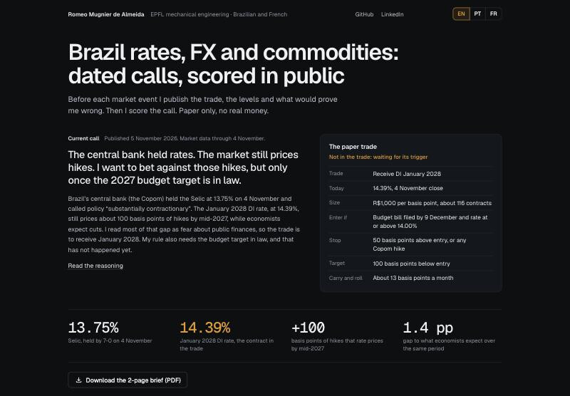

# Brazil Macro

Dated calls on Brazilian rates, FX and commodities, scored in public. Before each market event I publish the trade, the levels and what would prove me wrong; afterwards I score the call. The page also holds the reproducible studies behind those calls, an interactive risk lab and a check of the risk models.

Public site: https://brasilmacro.streamlit.app/ (English, `?lang=pt` Português, `?lang=fr` Français). Commodity desks can use the [commodity reading in English](https://brasilmacro.streamlit.app/?lens=commodities&lang=en) or [in Portuguese](https://brasilmacro.streamlit.app/?lens=commodities&lang=pt), which also opens the producer scenario first.

Educational research, not investment advice. Paper only: no real positions and no claimed performance.



## Current call (5 November 2026, after the Copom)

**The central bank held rates. The market still prices hikes. I want to bet against those hikes, but only once the 2027 budget target is in law.** Market data through 4 November, before the first session after the decision.

| | 23 Oct, before the vote | 26 Oct, after the vote | 4 Nov, Copom day |
| --- | ---: | ---: | ---: |
| USD/BRL, official PTAX | 5.0374 | 5.5003 | 5.4775 |
| January 2028 DI rate (press-reported) | 12.86% | 14.80% | 14.39% |
| Brent spot, US$ (latest 3 Nov) | 128.30 | 128.12 | 107.03 |
| U.S. 2-year Treasury yield | 4.69% | 4.68% | 4.58% |

- **What happened:** the Copom held the Selic at 13.75%, 7-0, after five straight 25 bp cuts. It raised its inflation forecasts (5.6% for 2026, 4.7% for 2027, 3.5% for mid-2028) and called policy "substantially contractionary", with activity slowing more sharply.
- **What is priced:** January 2028 at 14.39% needs about 100 bp of hikes by mid-2027. Economists (Focus) expect 12.50% at the end of 2027, an average of about 13.0% to that date. The gap is 1.4 pp. The 2-year rate is up 223 bp since 5 October, and 66% of that rise is implied inflation.
- **Why it looks too high:** the Copom is not signalling hikes, oil and U.S. yields have eased, and the position earns about 13 bp a month in carry and roll if nothing moves.
- **Why I am not in yet:** on 27 October I published three conditions. The hold and the firm tone are met. The budget target is stated but not in law, so the rule says wait, and a speech does not count.
- **The paper trade:** receive January 2028 at R$1,000 per bp (about 116 contracts), if a bill is filed by 9 December and the rate is at or above 14.00%. Stop 50 bp above entry or on any Copom hike; target 100 bp below. A repeat of 26 October's 194 bp jump would cost about R$195,000, which sets the size.
- **Scorecard:** 11 dated calls checked: 5 confirmed, 5 partly right, 1 missed. Paper trades entered: none yet. Waiting has already cost 41 bp of the move, and the note says so.

The note is on the homepage in English, Portuguese and French and as **two-page printable briefs** in `outputs/`. Its [frozen inputs](research/thesis_snapshot_2026-11-05.json) are the official snapshot committed at `44f12fa` plus official ANBIMA curves, the Copom statement and labelled press figures; [the saved publication](research/copom_2026-11-05.json) reproduces offline with `python scripts/build_copom.py`. [The method note](research/copom_method.md) records definitions, the rule test and the plan.

## Earlier notes

The [27 October note](research/runoff_2026-10-27.json), after the runoff, stays on the page under the scorecard and reproduces with `python scripts/build_runoff.py` ([method](research/runoff_method.md), briefs under `outputs/archive/2026-10-27/`). The [16 October note](research/update_2026-10-16.json) reproduces with `python scripts/build_update.py` ([method](research/update_method.md), briefs under `outputs/archive/2026-10-16/`). The original [6 October thesis](research/thesis_2026-10-06.json), its inputs, the election and commodity study and the 7 October risk diagnostic are unchanged; the closed long-real idea sits in the page's archive, and its briefs are under `outputs/archive/2026-10-06/`. `research/thesis.json` retains that historical context and points to the current publication through `current_update_file`.

## Risk lab and model diagnostic (7 October 2026)

`src/lab.py` offers three offline scenarios with editable assumptions and a CSV download of inputs and results:

- **Rates:** a hypothetical zero-coupon bond, with dated ANBIMA yield defaults, exact repricing, DV01 and the duration approximation. Change maturity, face value, yield and a parallel rate shock.
- **FX:** compounded BRL investment growth relative to USD cash, adjusted for an FX shock. Policy rates are indicative funding proxies, not executable forward quotes.
- **Producer:** BRL export revenue under commodity and FX shocks, with an illustrative forward conversion rate and a hedge fraction of actual scenario receipts. A joint-shock matrix shows the combined revenue effect.

The separate risk study was published on **7 October** using observations frozen through **5 October**. It reconstructs one-session 99% VaR and model-implied expected shortfall for a fixed BRL spot holding marked in USD. Each historical forecast uses only observations available before its evaluation date. Models and the evaluation period were chosen at publication; these forecasts were **not published prospectively**, and the period was not an independently reserved test set.

All models share **2,700 evaluation dates**, 4 January 2016–5 October 2026. Against a nominal **1% breach rate** (27 expected breaches):

| Model | Breaches | Observed breach rate |
| --- | ---: | ---: |
| Normal, rolling 20 sessions | 63 | 2.33% |
| Normal, EWMA λ = 0.94 | 61 | 2.26% |
| Historical, rolling 250 sessions | 36 | 1.33% |

The Normal models understate the observed frequency of large BRL losses. Kupiec's test measures unconditional breach frequency; it does not establish independence, conditional coverage or ES calibration. Historical simulation is not rejected at a 5% level against the nominal target, but its finite-window quantile granularity and possible breach clustering limit that interpretation. This is model validation, not a strategy-performance claim.

Run `python scripts/build_risk.py` offline to reproduce [the risk summary](research/risk_2026-10-07.json) and [every forecast and outcome](research/risk_forecasts.csv). The CSV records training dates, VaR, ES and breach indicators for all three models. [The method note](research/risk_method.md) documents loss units, time order, formulas, coverage-test limitations and scenario arithmetic. Latest next-session predictions at the frozen cutoff are separate from evaluated forecasts and have no observed outcome in this dataset.

## How it works

```
GitHub Actions (weekdays, 22:17 UTC)                      Streamlit Community Cloud
scripts/refresh_market_data.py                            app.py
  ├─ BCB: PTAX, Selic (SGS 432), Focus survey               reads research/thesis.json      (historical study + current publication pointer)
  ├─ New York Fed → Fed target range  (FRED fallback)       reads research/copom_*.json     (current dated decision)
  ├─ ...                                                    reads research/study_*.json     (the quantitative study)
  ├─ ...                                                    reads research/risk_*.json      (frozen risk diagnostic)
  ├─ ...                                                    reads research/live_snapshot.json (refreshed data)
  ├─ U.S. Treasury → 2y/10y yields   (FRED fallback)        renders cached HTML per language; no network, no pandas
  └─ FRED: Brent (EIA), iron ore / soy / sugar (IMF)
        │ each source validated independently
        ▼
research/live_snapshot.json  ──commit──▶  redeploy  ──▶  page shows every value with its own date and freshness
scripts/check_freshness.py   ──▶ run fails (owner notified) if key figures are > 1 week old
```

- **Visitors never trigger a data request.** The page reads local thesis, study, risk and refreshed-data files plus pre-generated PDFs. HTML is cached per language, lens and data version; scenario changes run local calculations only.
- **One failed feed never blanks or freezes the others.** Each source keeps its last good value, original date and an error message in `refresh.sources`; the page flags delayed or stale values instead of hiding them.
- **Honest refresh claims.** The page states when the job last ran and how many sources updated. Until 24 September 2026 the job reported success while every FRED request timed out on GitHub's runners, and the all-or-nothing build also discarded valid BCB data; the page kept showing 13 September figures. Sources are now independent, U.S. data has official fallbacks, and staleness turns the run red.
- **The thesis is never rewritten by the updater.** Current prose lives in `src/copom_content.py` (EN/PT/FR), with numbers from `research/copom_2026-11-05.json`. The earlier research prose lives in `src/content.py` (EN/PT/FR); thesis figures come from `research/thesis.json` and the quantitative study `research/study_2026-10-06.json`, built offline by `src/study.py` from frozen inputs (`research/thesis_snapshot_2026-10-06.json`, `research/study_inputs_2026-10-06.json`). The new risk diagnostic uses that same saved study input and is built separately by `scripts/build_risk.py`; it does not change the existing macro study or receive live updates. Homepage and lab copy lives in `src/lab_content.py`. The scheduled updater only refreshes market data; the page mechanically checks the pre-committed rules against new PTAX closes, including reversal of the first-Monday move.

## Run locally

Python 3.11 is the Community Cloud and CI target (3.9+ works).

```bash
python3.11 -m venv .venv
source .venv/bin/activate
python -m pip install -r requirements-dev.txt
python -m streamlit run app.py
```

Open http://localhost:8501 (add `?lang=pt` or `?lang=fr`).

```bash
python -m pytest -q                                   # mathematical, data, rendering and localization checks
python scripts/refresh_market_data.py                 # fetch official data (network)
python scripts/check_freshness.py                     # exit 1 if key data is stale
python scripts/collect_study_inputs.py               # fetch the study's raw inputs (network): PTAX since 2002, ANBIMA curves, IMF monthly prices, UN Comtrade
python scripts/build_copom.py                         # reproduce the current (5 November) note from frozen inputs
python scripts/build_runoff.py                        # reproduce the archived 27 October note
python scripts/build_update.py                        # reproduce the archived 16 October report
python scripts/build_study.py                         # recompute research/study_2026-10-06.json from those inputs (offline)
python scripts/build_risk.py                          # reproduce risk summary JSON and per-day audit CSV (offline)
python scripts/generate_market_brief.py               # regenerate the three PDFs + Markdown brief
```

Production installs only `requirements.txt` (Streamlit). The refresh job installs `requirements-refresh.txt` (pandas, requests); PDF generation and tests use `requirements-dev.txt`.

## Keeping the app awake

[Keep Streamlit Awake](.github/workflows/keep-streamlit-awake.yml) opens the public site in headless Chromium through Playwright at **00:23, 08:23 and 16:23 UTC every day**. The eight-hour cadence leaves a four-hour buffer against [Community Cloud's 12-hour inactivity window](https://docs.streamlit.io/deploy/streamlit-community-cloud/manage-your-app#app-hibernation). It clicks the wake-up button if needed, waits for the actual dashboard to render (including inside Streamlit's iframe), holds the browser session open for 15 seconds and retries one failed visit. No secrets or changes to the app's dependencies are needed.

The workflow also runs when its file is pushed to `main`, and can be started from **Actions → Keep Streamlit Awake → Run workflow**. It must be on the default branch for scheduled visits. A failed visit produces a failed Actions run; inspect that run's logs.

[Keep Repository Active](.github/workflows/keep-repository-active.yml) pushes an **empty commit to `main` on the first day of every month at 03:41 UTC** (at most 31 days between scheduled commits). This adds repository activity without changing any files, providing a backup if the market-data updater stops committing. It also runs when its workflow file changes on `main` and supports **Actions → Keep Repository Active → Run workflow**. It uses GitHub's built-in token with permission to write repository contents; no personal token or extra secret is needed. Token-generated pushes do not trigger further Actions runs, avoiding a commit loop.

This is best-effort availability: [GitHub can delay or drop scheduled runs and disables schedules in public repositories after 60 days without repository activity](https://docs.github.com/en/actions/reference/workflows-and-actions/events-that-trigger-workflows#schedule). If disabled, re-enable the workflow in Actions. The existing market-data refresh remains separate.

## Updating the thesis

Each publication owns its input cutoff, saved report, prose and decision. A follow-up must not rewrite an earlier event study or imply that a rule was published before it existed.

For the current publication:

1. Preserve the earlier publications and their frozen files; move the current briefs to `outputs/archive/<date>/`. Freeze the refreshed snapshot separately, recording the date of each feed. Prefer official downloads (e.g. a dated ANBIMA CSV with its request parameters); label any press-reported figure and keep its source. Do not substitute the latest monthly commodity observation for a current daily price.
2. Write the calculations and EN/PT/FR prose for the new note (currently `src/copom.py` and `src/copom_content.py`), then run its builder (`python scripts/build_copom.py`). Keep the order of the note: what happened, what is priced, why it looks wrong, why I am or am not in, the trade, what would prove me wrong, what I got wrong. Add the previous note's calls to the scorecard with a verdict. Keep calculations independent of the live snapshot. The report records the files it reviews; `current_update_file` selects the active note.
3. Run `python scripts/generate_market_brief.py`, inspect the PDFs, then run `python -m pytest -q`. The tests check independent numerical calculations, common-date oil/FX conversion, the unchanged historical study, language consistency, current-date rendering and committed PDF reproducibility.

The original study rebuild remains available through `scripts/build_study.py`. The 7 October risk diagnostic is frozen; any later risk publication must retain this version and document its own cutoff and evaluation choices.

## Tests

Checks cover independent-source refresh and fallbacks, malformed feeds and outages, freshness thresholds, thesis consistency, rule monitoring, localization and PDF reproducibility. Macro-study tests independently recompute event moves, volatility, forwards, curve decomposition, commodity regression and rule geometry from saved inputs.

Risk tests independently verify the exact BRL loss convention, Normal tail integrals, fractional historical-tail weights, EWMA update order, breach counts and Kupiec boundary cases. Same-day/future mutations and truncated histories check that earlier forecasts cannot change. The committed summary and CSV must reproduce offline. Scenario tests check DV01 units, shock signs, exact FX conversion, mixed producer shocks, hedge limits, invalid inputs and all three languages without network access. Missing or partial risk data must not break the market research. Layout and browser checks cover desktop and mobile; PDF checks cover searchable content, localization and agreement with the dated thesis.

## Files

- `app.py` — production entrypoint (Streamlit shell, caching, language/lens switches, interactive scenarios and downloads).
- `src/page.py`, `src/chart.py`, `src/style.css` — HTML sections (two lenses, ordered by `?lens=`), six inline-SVG figures (market pricing against economists, PTAX with the decision levels, zero curves, event paths, commodity scatter, producer prices), the design system.
- `src/study.py` — the quantitative study (pure standard library): event study, volatility, curve, commodity basket, rule geometry.
- `src/risk.py` — retrospective risk-model evaluation and deterministic scenario arithmetic (pure standard library).
- `src/lab.py`, `src/lab_content.py` — interactive scenario controls, CSV exports, and localized homepage/lab copy.
- `src/copom.py`, `src/copom_content.py` — current (5 November) publication calculations and EN/PT/FR prose.
- `scripts/build_copom.py`, `research/copom_2026-11-05.json`, `research/thesis_snapshot_2026-11-05.json`, `research/copom_method.md` — offline builder, saved report, frozen inputs and method note.
- `src/runoff.py`, `src/runoff_content.py`, `scripts/build_runoff.py`, `research/runoff_2026-10-27.json`, `research/thesis_snapshot_2026-10-27.json`, `research/runoff_method.md` — the archived 27 October publication.
- `src/update.py`, `scripts/build_update.py`, `research/update_2026-10-16.json`, `research/thesis_snapshot_2026-10-16.json` — the archived 16 October publication, still reproducible.
- `src/content.py` — archived research copy in English, Portuguese and French.
- `src/thesis.py`, `src/formatting.py`, `src/freshness.py` — thesis loading, rule check, calculations, locale formatting, freshness rules.
- `src/live_refresh.py`, `src/data.py`, `src/analytics.py` — scheduled refresh, source parsers, calculations (refresh job only).
- `src/pdf_brief.py` — printable brief and Markdown companion (offline only).
- `research/thesis.json`, `research/thesis_snapshot_2026-10-06.json`, `research/live_snapshot.json` — dated thesis, its frozen inputs (refreshed data plus the election count, final polls, ANBIMA curves and the 2014/2018/2022 PTAX windows), refreshed data.
- `research/study_inputs_2026-10-06.json`, `research/study_2026-10-06.json` — the study's raw inputs (PTAX since 2002, ANBIMA curves, IMF monthly prices, UN Comtrade export values) and its computed results.
- `scripts/build_risk.py` — offline risk builder; `research/risk_2026-10-07.json` — frozen diagnostic summary; `research/risk_forecasts.csv` — complete per-model/date audit; `research/risk_method.md` — methodology and limitations.
- `research/thesis_2026-10-05.json`, `research/thesis_snapshot_2026-10-05.json`, `research/thesis_2026-09-24.json`, `research/thesis_snapshot_2026-09-24.json` — the previous theses and their inputs, preserved unchanged.
- `research/data_snapshot.json`, `research/commodity_snapshot.json`, `research/scenario_trade.md` — archived 13 September case.
- `static/fonts/` — Geist and Geist Mono (SIL Open Font License), served through Streamlit's static file serving and declared in `.streamlit/config.toml`.
- `outputs/` — the three current PDFs; `outputs/archive/` keeps earlier briefs. `tests/` — automated checks.

## Limits

The 5 November note's DI rates, Ibovespa, front-month Brent and surveys are press-reported and labelled as such. The hikes-priced figure assumes one path shape, and forward rates and breakevens contain premia, so neither is a forecast. Its trade plan is paper only: it ignores costs, margin, liquidity and execution, and nothing has been entered.

PTAX is a daily reference rate, not an executable price. The paper-trade monitor checks conditions; it does not reconstruct fills, costs, carry, position sizing or realised strategy P&L, and no full trading strategy is back-tested. The lab lets visitors change face values, receipts and hedge fractions to explore exposure; these are hypothetical scenarios, not sizing recommendations or implemented trades. Its zero-coupon bond is not a DI future, policy rates are not executable funding quotes, and producer revenue conversion is not profit or a fixed-notional derivative payoff. Basis, collateral, production costs and execution costs are omitted.

The risk study is a retrospective reconstruction with lagged inputs, not prospectively published forecasts or an independently reserved test set. Kupiec assesses aggregate nominal breach frequency only; it does not validate independence, conditional coverage or expected shortfall. A non-rejection is not proof of calibration. Historical quantile granularity, serial dependence and regime changes matter. Latest predictions have no evaluated outcome in the frozen data.

The 27 October note's DI rates, Ibovespa, spot close and 27 October PTAX are press-reported and labelled as such; the 26 October January 2028 DI is a late-afternoon quote, not a settlement, and no ANBIMA curve is saved for that date. ANBIMA's fitted zero curve is saved at 2 and 5 October; it is not live. Focus predates the vote, and the curve–survey gap mixes expectations and premia; breakeven inflation contains inflation-risk and liquidity premia. Press-reported 5 October figures (Ibovespa, DI futures, spot dollar, Brent, Petrobras) come from the live session. The contemporaneous commodity regression uses fixed 2025 weights retrospectively, covers 44% of exports and does not identify causes or forecast FX; IMF series end in July 2026. The random-walk benchmark has no drift and a hand-picked runoff-session shock; its percentages concern one close, not the full entry rule. No election probabilities are assigned, and only three completed first-round moves exceed 2σ. Community Cloud can still take a few seconds to wake a sleeping app.
